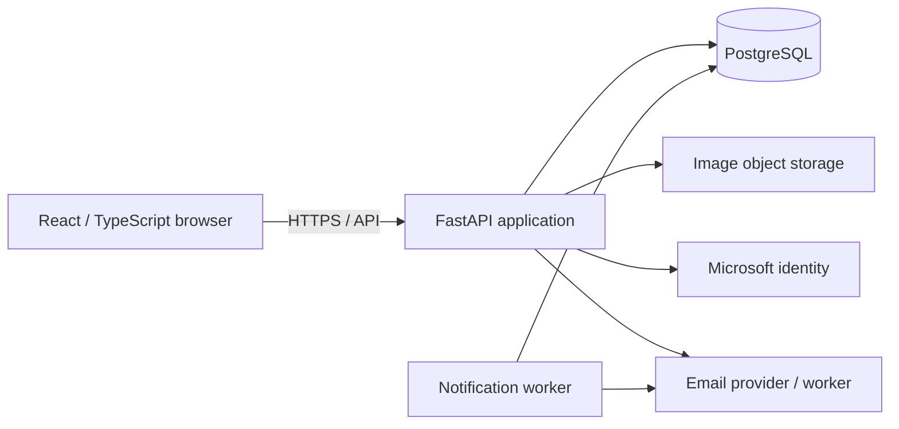

# CLIP developer guide

This guide maps the repository and everyday development flow. Start with the [README](README.md) for setup and [PRD](PRD.md) for product requirements. The [documentation index](docs/README.md) links canonical contracts, decisions, current task records, and operational guides. Historical checkpoint text can describe an earlier version; check current code and the [work log](docs/status/work-log.md) before treating it as current behavior.

## Architecture at a glance



The backend owns authorization and authoritative transactions. The browser sends requests to the API and holds private messaging keys; message content is encrypted on the client and stored and relayed as ciphertext. PostgreSQL stores application state and supports native text search. Object storage holds image bytes while listing records own image metadata. Providers and background work need explicit configuration; the diagram shows intended relationships, not proof that every deployment or integration is ready.

## Repository map

| Path | Responsibility |
|---|---|
| `apps/web/src/app/` | Router, shell, providers, navigation and app-level wiring. |
| `apps/web/src/pages/` | Route composition connecting public feature entry points. |
| `apps/web/src/features/identity/` | Session, sign-in, account, contact and eligibility UI. |
| `apps/web/src/features/listings/` | Sale listings, image and owner workflows. |
| `apps/web/src/features/search/` | Discovery, wanted requests, and saved listings. |
| `apps/web/src/features/conversations/` | Inbox, encrypted messaging, offers, contact sharing, and unread state. |
| `apps/web/src/shared/` | Shared HTTP, styles, and UI primitives. |
| `apps/web/tests/` | Frontend behavior, integration-adapter, and architecture tests. |
| `apps/api/app/main.py`, `application.py` | API entry point and application composition. |
| `apps/api/app/core/` | Shared configuration, infrastructure and cross-cutting API behavior. |
| `apps/api/app/domains/identity/` | Identity, eligibility, sessions, account and notification destinations. |
| `apps/api/app/domains/listings/` | Listing lifecycle, image metadata, delivery and search-related listing data. |
| `apps/api/app/domains/search/` | Discovery, wanted requests and saved-listing behavior. |
| `apps/api/app/domains/conversations/` | Conversation transport, offers, read state, contact sharing and notification production. |
| `apps/api/tests/`, `tests/` | Domain and cross-domain tests, fixtures, and contract checks. |
| `contracts/source/`, `contracts/generated/` | Editable contract sources and generated artifacts; regenerate rather than hand-edit generated files. |
| `database/migrations/` | Ordered PostgreSQL schema and integrity migrations. |
| `data/` | Synthetic data generators, formats, validation and evaluation inputs. |
| `infra/` | Terraform and related infrastructure configuration; see its own runbooks before use. |
| `scripts/` | Check runners, local inspection, maintenance and evaluation tools. |
| `docs/` | Requirements, decisions, tasks, environment procedures, evidence and status. |
| `.github/workflows/` | CI configuration. |

See the [repository map](docs/architecture/repository-structure.md), [frontend collaboration map](docs/architecture/frontend-collaboration.md), [API guide](apps/api/README.md), and [contract guide](contracts/README.md) for ownership and public interfaces.

## Request and UI flow

The browser router selects a page, which composes feature-owned components. Features call the shared API using their public adapters; Vite proxies `/api` to `127.0.0.1:8000` during development. FastAPI mounts domain routes and dependencies, derives the caller from trusted session state, checks permissions, and calls domain services and stores. Database migrations define persistent schema and integrity constraints. A UI guard improves navigation but is not authorization. Contact details and conversation content require participant-scoped authorization.

The route inventory and page owners are in [frontend collaboration](docs/architecture/frontend-collaboration.md). For changes that cross domains, use their documented public entry points and contracts rather than importing private implementations. Coordinate shared shell, styles and page composition with the affected owners.

## Local development

Use the [README setup](README.md#prerequisites) and run `make start-api` and `make start-web` in separate terminals. `make start-db`, `make migrate`, and `make migration-status` manage the local database as documented in the [database guide](database/README.md). Database and provider configuration are separate from launching the processes. The API reads process environment variables, not `.env.example` automatically. Do not put credentials into source, logs or fixtures; use the [secret-handling guide](docs/environment/secret-handling.md).

For a self-contained UI walkthrough, the [synthetic inspection procedure](README.md#explore-with-synthetic-accounts) runs the normal built app with disposable data and test provider replacements. It is not a live-provider or production acceptance test. Microsoft authentication, mail and object storage need their own configured integration paths; do not treat a preview as proof of them. Browser encryption requires a secure context; localhost qualifies for local use, while ordinary HTTP on a LAN IP generally does not.

## Checks and generated artifacts

```bash
npm run lint             # Biome on frontend source and tests
npm test                 # Vitest frontend suite
npm run typecheck        # TypeScript app and test configurations
npm run build            # Typecheck and build apps/web/dist
npm run check            # All four frontend checks
make contracts-check     # Verify generated contracts match their sources
make check               # Full local CI-equivalent suite
```

`make check` includes Python, contracts, frontend, database and secret checks and may require local Docker and pinned tools; see the [command registry](docs/environment/commands.md) and [CONTRIBUTING.md](CONTRIBUTING.md). Some tests intentionally skip when their isolated fixture or integration driver is absent; report those skips. `make contracts-generate` changes generated outputs; inspect them against the canonical sources. `make format` changes Python files, while `make format-check` checks them. `npm run preview` serves a previously built bundle on loopback at port 4173, and is separate from the synthetic inspection launcher.

## Data, migrations and safety

Migrations live in `database/migrations/` and run in order. `make migrate` applies pending migrations to the configured local database; `make seed` invokes the migration path and does not make demo users. `make stop-db` retains the local volume. Never reset or point a local procedure at a shared database to work around an error. See [database/README.md](database/README.md) for platform, role, migration and recovery details.

The [data guide](data/README.md) describes synthetic datasets and their validation. Test fixtures and provider doubles have explicit scopes: passing an isolated check does not establish real-provider integration. No cloud deployment, load test, infrastructure apply, or paid service action is implied by a local build or PR; use the relevant reviewed plan and separate approvals.

## Contribution and review

Follow [CONTRIBUTING.md](CONTRIBUTING.md), [AGENTS.md](AGENTS.md), the relevant task and work-log checkpoint, and the ownership map. Use a task branch; preserve unrelated changes; include focused tests and documentation for behavior changes; and inspect the complete diff before requesting review. The project requires explicit approval before each commit. A designated independent human peer and affected owners review the exact PR; use the [peer review prompt](docs/prompts/peer-review-prompt.md). Merge also needs required passing checks and explicit authorization of the reviewed revision.
