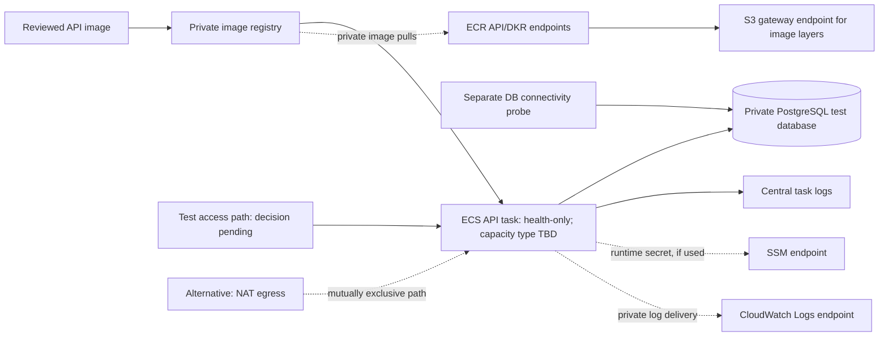

# PD-16 Shared Test Foundation Proposal

**Status:** Draft for review. This proposal does not authorize planning, provisioning, deployment, or cleanup.

## Purpose and scope

Prepare one small shared AWS environment for integrated feature testing. The initial deployment is limited to the API process-health skeleton and a private PostgreSQL connectivity check. It does not include marketplace behavior, final synthetic data, NFR measurements, email delivery, or the ECS/Lambda experiment.

## Recorded constraints

- The selected target is account `335523638354`, Region `ap-south-1`. The latest recorded identity and resource snapshot are from 2026-10-17. Before planning, verify the active identity using an explicitly approved profile; this runtime has only an unapproved `default` profile.
- The account budget's USD 200 amount is a notification reference, not a spending cap. The USD 50 actual-spend notification is the pause-and-review point. Rahul reported USD 140 in credits; the amount and eligibility are not independently verified. Current spend, quota utilization, and remaining headroom are unknown.
- No CLIP resources were recorded in the 2026-10-17 inventory. Existing untagged VPCs and S3 buckets must not be adopted.
- The selected remote state is S3 with native lockfiles, versioning, and SSE-S3. The bootstrap bucket and remote state migration have not been provisioned. Shared-root remote planning must wait until the separate bootstrap plan and migration gates pass.
- The API exposes only `/health`, which reports process liveness and does not check PostgreSQL. The web app is a local scaffold; no hosting target is configured.
- The S3 image bucket may be deferred to LI-02, as allowed by PD-16 Step 6. No final synthetic dataset exists yet; the initial cloud check must not depend on it.

## Proposed minimum architecture

The resource inventory should evaluate a dedicated VPC and security groups, a private image registry, an ECS API service, managed private PostgreSQL (RDS is a candidate), task/deployment roles, bounded log retention, and the path needed for private tasks to pull images and send logs. The ECS capacity type, database size, image build/publish route, and private outbound path are not selected. No existing account VPC or bucket is assumed reusable. The health endpoint remains a liveness check; database connectivity must be verified separately with a bounded probe that uses synthetic/no domain data. A `pg_isready`-style check would establish network reachability and server availability, not authenticated SQL access; the exact check and any credential flow remain to be reviewed.

AWS documents that private Fargate tasks need a route for image pulls. For private ECR, the candidate no-NAT path needs ECR API and Docker registry interface endpoints plus an S3 gateway endpoint for image layers; private log delivery and runtime Parameter Store reads may need CloudWatch Logs and SSM interface endpoints. The alternative is NAT egress, which adds hourly and data-processing charges. Neither path is selected. The private test-access method is also open; it may add access-path resources and cost.

See AWS [Fargate task networking](https://docs.aws.amazon.com/AmazonECS/latest/developerguide/fargate-task-networking.html) and [ECR VPC endpoint requirements](https://docs.aws.amazon.com/AmazonECR/latest/userguide/vpc-endpoints.html) for the image-pull path.

No internet-facing listener is selected. Two access approaches remain for review:

1. **Private access:** run the health and database probes from an approved test task inside the VPC. This avoids public ingress but requires a usable operator/test path and the associated network controls.
2. **HTTPS ingress:** add a narrowly scoped public HTTPS entry point only after the team specifies the hostname/certificate and access boundary. Do not expose an unauthenticated HTTP endpoint or open ingress to the internet by default.

Web hosting remains a later prerequisite because no hosting target is configured. Object storage remains with LI-02 unless the approved plan identifies an earlier need. Do not add Lambda, email, domain services, load generators, or final data resources to this foundation.

Parameter Store `SecureString` under `/clip/` is the selected secret store, but no database parameter or tested access policy exists. Any credentialed probe must use a reviewed secure setup path; secret values must not enter Terraform state, plans, logs, or Git.

## Step 3 resource, cost, quota, and lifecycle inventory — draft

This is a resource-level cost model, not a final estimate or approval. Unless a row says otherwise, the owner is the PD-16 task owner (the accountable human/operator is not selected); the Terraform root/state is `infra/terraform/shared/test/` / `shared/test/terraform.tfstate`; no module is selected yet; resources are private; and data is limited to synthetic test content and non-sensitive runtime metadata. Adding a module before its interface and capability are approved would conflict with the Terraform ownership guidance. A named human owner is needed for the required `Owner` tag before an exact plan is prepared.

The reference duration below is 30 days (720 running hours), solely to make the formulas comparable. The actual task lifetime, idle schedule, availability-zone count, task size/architecture, database class, image size, log volume, and current Mumbai prices are unresolved. Therefore the table does not claim a numeric total or remaining-budget reserve. Prices are in USD before any applicable credits/tax.

| Resource and purpose | Exposure and data | Monthly cost / 30-day reference | Quota | Retention and cleanup |
|---|---|---|---|---|
| Dedicated VPC, private subnets, route tables, security groups, and internet gateway: isolate the API task and database. | No public database or task IP; synthetic test traffic only. | VPC components have no hourly charge; the 30-day base is $0. Public IPv4, data transfer, NAT, and interface endpoints are excluded and cost separately. | Existing VPC/subnet/security-group capacity and utilization are not recorded; headroom unknown. | Keep only while the shared test environment is approved; remove through the shared/test Terraform state after dependent services are removed. |
| S3 gateway endpoint: private access to ECR image layers. | Private route-table attachment; AWS-managed ECR image-layer transfer, no project/user data. | No additional gateway-endpoint charge; $0 for 30 days. | Gateway-endpoint quota/headroom not recorded. | Remove with the VPC after the image-pull path is no longer needed. |
| ECR API and Docker registry interface endpoints: private image manifest/registry access. | Private VPC endpoints; container images only, with no credentials or data baked into images. | Hourly charge per endpoint per enabled AZ plus per-GB processing. Formula: `720 × endpoints × AZs × regional hourly rate + GB × regional processing rate`. Mumbai rates and AZ count are not captured. | VPC endpoint quota/use not recorded. | Remove with the private task path during approved teardown. |
| CloudWatch Logs interface endpoint: deliver task logs without general internet egress, if the no-NAT path is chosen. | Private endpoint; bounded, redacted process logs only. | Hourly charge per endpoint per AZ plus processed data; regional rates and log volume not captured. | Endpoint quota/headroom not recorded. | Remove with the VPC; log-group retention is separately proposed below. |
| SSM interface endpoint: retrieve the database credential at runtime if the selected Parameter Store path is used without NAT. | Private endpoint; credential remains in Standard `SecureString`, with value excluded from Terraform state, plans, Git, and ordinary logs. | Hourly charge per endpoint per AZ plus processed data; regional rate and call volume not captured. The Standard parameter itself has no additional Parameter Store charge. | Endpoint and Standard-parameter usage/headroom not verified. | Remove the parameter only after the service/database are removed; remove the endpoint at teardown. Keep the selected manual-rotation policy; do not invent a cadence. |
| NAT gateway, the alternative private-egress path. | Outbound-only route; no public inbound path. | Hourly charge per gateway plus per-GB processing and applicable data transfer. Mumbai rates, egress volume, and gateway/AZ count are not captured. A published Ohio example is not a Mumbai estimate. | NAT/EIP quota value is 5 EIPs, but utilization/headroom is unknown. | Delete through Terraform after private tasks are stopped and no approved consumer remains. |
| Private API health-test access: a bounded probe must reach the service without a public listener. No access resource/path is selected. | Private; synthetic health request only. | Not estimable until the method is chosen; a probe task, ECS Exec, service discovery, or another path has different resources and charges. Excluded from current subtotal. | Depends on the selected method; current usage/headroom is unknown. | Run only for approved checks; remove any access-only resources with the test environment. |
| Private ECR repository: hold the reviewed API image. | Private; software artifact only. | `stored GiB × regional per-GiB-month rate`; image size/count and Mumbai rate are not captured. AWS's ECR page provides an example rate but not a verified Mumbai estimate. | ECR quotas and current use are not recorded. | Retain while the environment is used; delete repository/images on approved teardown after confirming no consumer needs the image. No lifecycle count is selected. |
| ECS cluster/service and one Fargate API task: keep the health-only API available. | Task in private subnet; API has no public listener in this proposal. Synthetic checks only. | ECS orchestration has no separate fee. Candidate task only: one Linux task at `0.25 vCPU / 0.5 GiB` for 720 hours, formula `720 × (0.25 × regional vCPU-hour rate + 0.5 × regional GB-hour rate)`. Size, CPU architecture, and Mumbai rates are unselected/unverified. | One service (recorded default limit: 5,000 per cluster); account use/headroom unknown. Fargate quotas not recorded. | Stop task when the agreed environment is idle; remove service/cluster at teardown. A single task/AZ is not high availability. |
| RDS for PostgreSQL: private disposable integration database. | Private subnet/security-group access; synthetic data only, no PD-09 dataset required. | Candidate Single-AZ, smallest verified suitable class, 20 GiB General Purpose SSD, 7-day automated backup. Formula: `720 × instance-hour rate + 20 × storage GB-month rate + billable backup/IO/transfer`. Class availability, rates, and backup cost are not captured; Multi-AZ is excluded from this low-cost draft. | Recorded applied RDS DB-instance limit: 20; account usage/headroom unknown. Storage utilization/headroom unknown. | Candidate 7-day backup window; final snapshot is not assumed. Remove only after approved data-retention/teardown decision; delete backups/snapshots only within that approved cleanup. |
| IAM task-execution and application task roles: image pull, log delivery, and narrowly scoped runtime reads. | No direct data exposure; grants only required resource actions and references. | IAM roles have no additional charge; $0 for 30 days. | IAM quotas/permission effectiveness not verified; current policy scope must be reviewed. | Remove with the resources/policies they serve, after dependent tasks stop. |
| Standard `SecureString` parameter: database credential reference for an authenticated connectivity probe, if needed. | Secret data; synthetic-test DB credential only. | Standard Parameter Store storage and standard-throughput API calls have no additional charge. Do not select higher throughput or Advanced tier. | Standard tier limit is 10,000 parameters/Region; `/clip/` is currently empty in the recorded snapshot; live usage not refreshed. | Candidate lifetime matches the test database; delete after DB teardown. Terraform must use the provider's write-only value path and the value must be absent from state/plan/logs; no actual secret is available or included in this proposal. |
| CloudWatch log group: retain bounded API startup/health logs for diagnosis. | No secret, message plaintext, contact data, or real user data; redaction required. | Ingested GB × regional ingestion rate + stored GB-month × regional storage rate. Volume/rates not captured. Candidate retention is 7 days, subject to review. | Log-group/account quotas and usage not recorded. | Set finite retention (7 days is a proposal); delete the group at teardown after the agreed evidence window. |
| Optional public HTTPS ingress (ALB plus approved host/certificate): expose only if private test access is impractical. | Public listener only after an explicit need, hostname, certificate, and source/access boundary are approved; database stays private. | ALB hours + LCU usage + public IPv4/DNS-related costs; target-region rate, traffic, hostname, and certificate/access design are unknown. Excluded from the base estimate. | Recorded ALB quota: 50; current use/headroom unknown. | No resource selected. If later approved, remove on agreed expiry/teardown and clean up the associated DNS/certificate resources according to their owning records. |
| One-shot database probe task: perform authenticated SQL connectivity without marketplace data. | Runs privately and exits; synthetic/no domain data. | Fargate per-second CPU/memory rate with 1-minute minimum; actual task size/runtime and Mumbai rates not captured. No standing monthly task. | Shares task/quota constraints above. | Run only for bounded checks; task stops on exit and is not retained as a service. |

The S3 image bucket remains deferred to LI-02 and is outside this resource list; no bucket is included in the shared test plan unless the approved plan establishes an earlier required test. Web hosting is also deferred. The separately gated PD-15 state bucket/bootstrap/migration is a prerequisite and its storage/request/version-retention charges must be included in the overall reserve, even though it is not owned by the shared/test root.

Official pricing references: [VPC](https://aws.amazon.com/vpc/pricing/), [interface endpoints](https://docs.aws.amazon.com/vpc/latest/privatelink/privatelink-access-aws-services.html), [Fargate](https://aws.amazon.com/fargate/pricing/), [ECS](https://aws.amazon.com/ecs/pricing/), [RDS for PostgreSQL](https://aws.amazon.com/rds/postgresql/pricing/), [ECR](https://aws.amazon.com/ecr/pricing/), [CloudWatch](https://aws.amazon.com/cloudwatch/pricing/), [Parameter Store](https://aws.amazon.com/systems-manager/pricing/), and [AWS Pricing Calculator](https://calculator.aws/). These pages establish billing dimensions; the exact `ap-south-1` line items and selected SKUs still need to be entered and retained with the Step 4 estimate. AWS's Fargate documentation describes regional pricing by requested vCPU, memory, OS, architecture, and duration; the RDS page prices instance class, deployment and storage; interface endpoints bill per endpoint-hour/AZ and per processed GB; NAT bills per gateway-hour and processed GB.

The database credential must not use Terraform's ordinary `value` argument because the canonical secret policy excludes secret values from state. The repository pins Terraform 1.15.9; AWS provider 6.69.1 is locked in the bootstrap root, but the shared/test root has no provider lock yet. Current provider documentation exposes `value_wo` as a write-only argument supported by Terraform 1.11+ ([provider resource documentation](https://registry.terraform.io/providers/hashicorp/aws/latest/docs/resources/ssm_parameter)). This is a viable implementation candidate, not yet validated with the shared root's provider version. The exact plan should use an ephemeral input and verify that secret values are absent from the saved plan, state, command output, and logs before any apply.

### Step 3 findings and open inputs

- Private image pull/log delivery is a material cost path omitted from the first architecture sketch. Keep NAT versus private endpoints open until a Mumbai cost comparison and AZ/availability choice are reviewed.
- The non-public test route is not yet designed. The plan must show how a bounded health request reaches the private API and how the authenticated database probe runs, without silently adding a public endpoint or access service.
- Current prices, monthly total, 30-day total, eligible-credit coverage, remaining-budget reserve, resource owner name/tag, exact quotas/headroom, duration/expiry, database/task sizes, image/log volumes, and cleanup owner are not established. Step 3 remains partial and Step 4 must stop until these inputs are resolved and the exact plan can be reviewed.
- No AWS API, Terraform plan, resource change, secret creation, or cloud operation was performed.

## Approval and planning gates

Before any remote plan, select and verify the approved account/profile, refresh spend and quota evidence, and complete the separately approved S3 backend bootstrap and migration. Then prepare the shared/test plan against `shared/test/terraform.tfstate`. Keep saved plans and state outside Git. The exact resource set, private egress/test-access path, ingress, role policies, region-specific cost/reserve, retention, named owner/operator, and cleanup/lifecycle still require human review and explicit approval. Any changed plan requires renewed approval.

## Canonical sources

- [PD-16 task requirements](../tasks/pre-domain-task-list.md#pd-16--review-and-provision-the-shared-cloud-test-foundation)
- [Cloud inventory and budget constraints](cloud-inventory.md)
- [Terraform state ownership](../architecture/terraform-ownership.md)
- [Terraform plan/apply workflow](../../infra/terraform/README.md)
- [Bootstrap and recovery procedure](../../infra/terraform/bootstrap/README.md)
- [API foundation and health semantics](../../apps/api/README.md)
- [Web scaffold and local-only status](../../apps/web/README.md)
