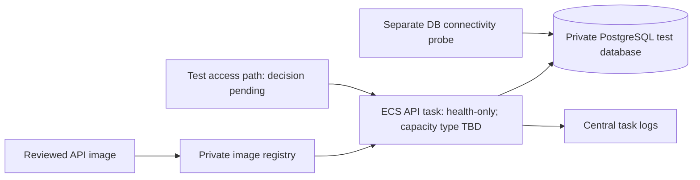

# PD-16 Shared Test Foundation Proposal

**Status:** Draft for review. This proposal does not authorize planning, provisioning, deployment, or cleanup.

## Purpose and scope

Prepare one small shared AWS environment for integrated feature testing. The initial deployment is limited to the API process-health skeleton and a private PostgreSQL connectivity check. It does not include marketplace behavior, final synthetic data, NFR measurements, email delivery, or the ECS/Lambda experiment.

## Recorded constraints

- The selected target is account `335523638354`, Region `ap-south-1`. The latest recorded identity and resource snapshot are from 2026-10-17. Before planning, verify the active identity using an explicitly approved profile; this runtime has only an unapproved `default` profile.
- The account budget's USD 200 amount is a notification reference, not a spending cap. The USD 50 actual-spend notification is the pause-and-review point. Rahul reported USD 140 in credits; the amount and eligibility are not independently verified. Current spend, quota utilization, and remaining headroom are unknown.
- No CLIP resources were recorded in the 2026-10-17 inventory. Existing untagged VPCs and S3 buckets must not be adopted.
- The selected remote state is S3 with native lockfiles, versioning, and SSE-S3. The bootstrap bucket and remote state migration have not been provisioned. Shared-root remote planning must wait until the separate bootstrap plan and migration gates pass.
- The API exposes only `/health`, which reports process liveness and does not check PostgreSQL. The web app is a local scaffold; no hosting target is configured.
- The S3 image bucket may be deferred to LI-02, as allowed by PD-16 Step 6. No final synthetic dataset exists yet; the initial cloud check must not depend on it.

## Proposed minimum architecture

The resource inventory should evaluate a dedicated VPC and security groups, a private image registry, an ECS API service, managed private PostgreSQL (RDS is a candidate), task/deployment roles, and bounded log retention. The ECS capacity type, database size, and image build/publish route are not selected. No existing account VPC or bucket is assumed reusable. The health endpoint remains a liveness check; database connectivity must be verified separately with a bounded probe that uses synthetic/no domain data. A `pg_isready`-style check would establish network reachability and server availability, not authenticated SQL access; the exact check and any credential flow remain to be reviewed.

No internet-facing listener is selected. Two access approaches remain for review:

1. **Private access:** run the health and database probes from an approved test task inside the VPC. This avoids public ingress but requires a usable operator/test path and the associated network controls.
2. **HTTPS ingress:** add a narrowly scoped public HTTPS entry point only after the team specifies the hostname/certificate and access boundary. Do not expose an unauthenticated HTTP endpoint or open ingress to the internet by default.

Web hosting remains a later prerequisite because no hosting target is configured. Object storage remains with LI-02 unless the approved plan identifies an earlier need. Do not add Lambda, email, domain services, load generators, or final data resources to this foundation.

Parameter Store `SecureString` under `/clip/` is the selected secret store, but no database parameter or tested access policy exists. Any credentialed probe must use a reviewed secure setup path; secret values must not enter Terraform state, plans, logs, or Git.

## Approval and planning gates

Before any remote plan, select and verify the approved account/profile, refresh spend and quota evidence, and complete the separately approved S3 backend bootstrap and migration. Then prepare the shared/test plan against `shared/test/terraform.tfstate`. Keep saved plans and state outside Git. The exact resource set, ingress, role policies, cost/reserve, retention, named operator, and cleanup/lifecycle still require human review and explicit approval. Any changed plan requires renewed approval.

## Canonical sources

- [PD-16 task requirements](../tasks/pre-domain-task-list.md#pd-16--review-and-provision-the-shared-cloud-test-foundation)
- [Cloud inventory and budget constraints](cloud-inventory.md)
- [Terraform state ownership](../architecture/terraform-ownership.md)
- [Terraform plan/apply workflow](../../infra/terraform/README.md)
- [Bootstrap and recovery procedure](../../infra/terraform/bootstrap/README.md)
- [API foundation and health semantics](../../apps/api/README.md)
- [Web scaffold and local-only status](../../apps/web/README.md)
